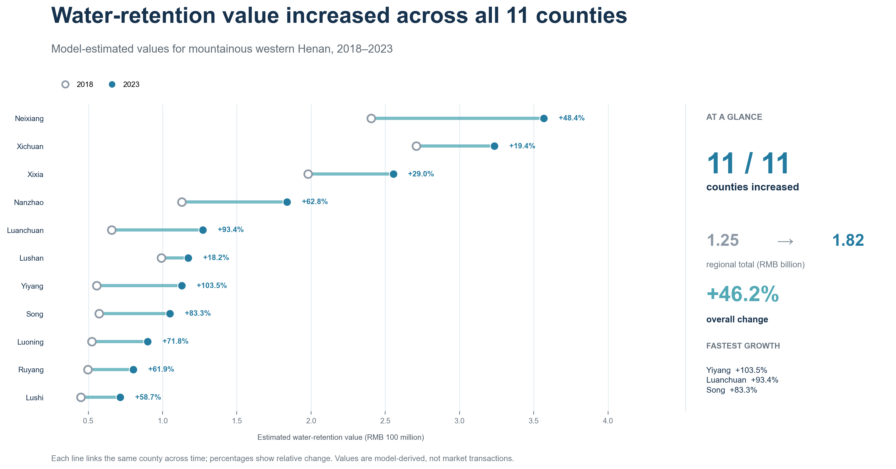
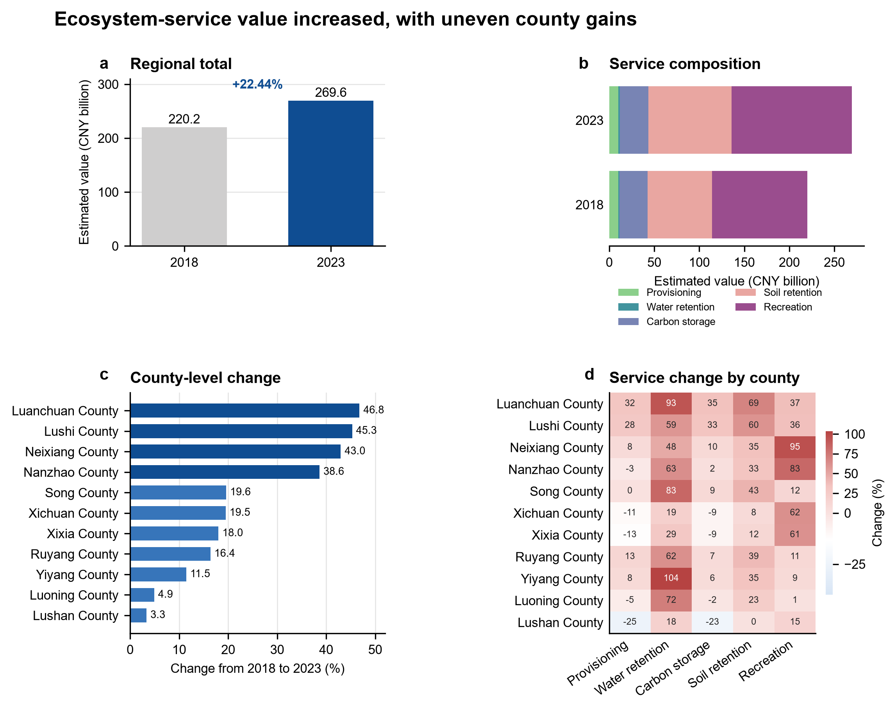
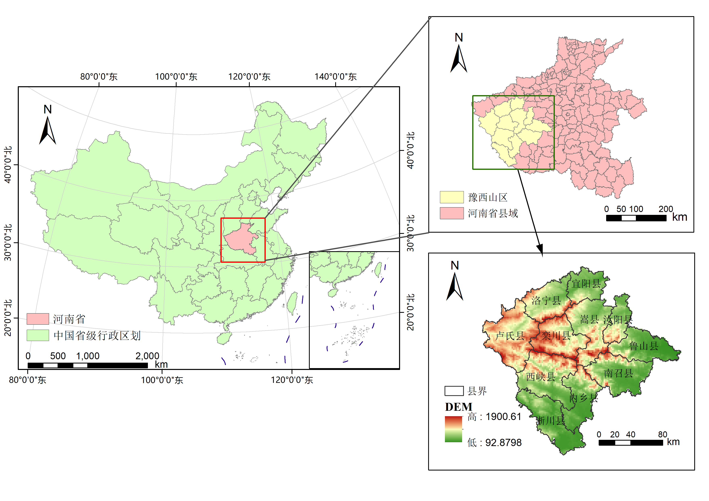
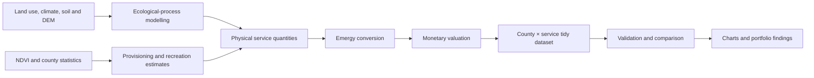

# Ecosystem-service valuation in mountainous western Henan

**A reproducible county-level analysis of ecosystem-product values derived from an undergraduate thesis**




*Featured result — a fully reproducible, English-language comparison of county-level water-retention value in 2018 and 2023. Each line links the same county across time; values are expressed in RMB 100 million.*

## Project at a glance

| Item | Scope |
|---|---|
| Research area | 11 mountainous counties in western Henan, China |
| Time points | 2018 and 2023 |
| Ecosystem services | Grain provision, water retention, carbon storage, soil retention, recreation |
| Valuation framework | Ecological-process modelling + emergy-based monetary conversion |
| Public reproducibility | Cleaned county results, validation, aggregation, comparison and visualisation |
| Explicit boundary | The upstream InVEST/geospatial modelling is **not** claimed as fully reproducible |

## Research question

How did the scale, composition and county distribution of ecosystem-service value change in mountainous western Henan between 2018 and 2023?

The original thesis combined biophysical modelling, socioeconomic statistics and emergy analysis. This repository turns its final county-level results into a transparent portfolio workflow: one tidy dataset, automated integrity checks, executable notebooks and reusable visualisations.

## Main findings



- Total estimated ecosystem-product value increased from **CNY 220.19 billion** in 2018 to **CNY 269.60 billion** in 2023, a **22.44%** increase.
- Recreation contributed **49.66%** of the 2023 total, followed by soil retention at **34.17%**.
- Water-retention value grew fastest (**46.24%**), from CNY 1.25 billion to CNY 1.82 billion, while remaining the smallest category by value.
- County-level growth ranged from **3.35%** in Lushan to **46.80%** in Luanchuan; Lushi and Neixiang also recorded growth above 40%.
- Carbon-storage value changed comparatively little (**+1.86%**), suggesting a relatively stable stock over the two observed years.

These are model-derived estimates rather than observed market transactions. The comparisons are descriptive and do not establish that any individual policy or project caused the change.

## Study area



The study covers Yiyang, Song, Luanchuan, Nanzhao, Neixiang, Xixia, Xichuan, Lushi, Ruyang, Lushan and Luoning. The region spans the Funiu, Xiong'er and Waifang mountain systems, with marked elevation and north–south climatic differences. This environmental heterogeneity is central to the county comparison.

## Analytical framework



| Service | Biophysical or statistical basis | Valuation route |
|---|---|---|
| Grain provision | County grain output spatially allocated with NDVI | Product quantity → emergy → monetary value |
| Water retention | Water yield, evapotranspiration and runoff processes | Retained water → emergy → monetary value |
| Carbon storage | Aboveground, belowground, soil and dead-organic-matter pools | Stored carbon → emergy → monetary value |
| Soil retention | Difference between potential and actual soil loss using R/K/LS/C/P factors | Retained soil → emergy → monetary value |
| Recreation | Land use, slope, landscape diversity and tourism statistics | Recreation proxy → emergy → monetary value |

More detail is available in [research context](docs/thesis_context.md) and [methodology and scope](docs/methodology.md).

## What this repository demonstrates

- converting thesis workbooks into a documented tidy-data schema;
- detecting and correcting a broken spreadsheet summary formula;
- validating 110 county–service–year observations with automated tests;
- separating reproducible analysis from non-public upstream modelling;
- communicating results through notebooks, charts and concise methodological notes.

## Reproducible scope

The repository starts from the included processed CSV and reproduces schema checks, county and service aggregation, 2018–2023 comparisons, reconciliation of totals and English-language charts. It does **not** reproduce the original InVEST run because complete raster inputs, parameter files, licensed county boundaries and the full model workspace are unavailable for public release.

```text
data/processed/                  Clean county-service values
docs/                            Research, method and data-quality notes
notebooks/                       Executed validation and analysis notebooks
outputs/charts/                  Generated PNG and editable SVG figures
outputs/maps/                    Selected original thesis maps + provenance note
scripts/                         Dataset migration and full rebuild commands
src/                             Reusable analysis and plotting code
tests/                           Automated integrity checks
```

## Run locally

```bash
python -m venv .venv
# Windows: .venv\Scripts\activate
# macOS/Linux: source .venv/bin/activate
python -m pip install -r requirements.txt
python scripts/run_analysis.py
python -m pytest
```

To execute the notebooks in place:

```bash
jupyter nbconvert --to notebook --execute --inplace notebooks/01_data_validation.ipynb
jupyter nbconvert --to notebook --execute --inplace notebooks/02_temporal_comparison.ipynb
jupyter nbconvert --to notebook --execute --inplace notebooks/03_county_comparison.ipynb
```

## Data quality and interpretation

The source workbook's 2023 summary formula referenced the wrong row range. This project ignores that cell and recomputes every aggregate from the 11 county rows, producing a corrected 2023 regional total of **2696.03 亿元** (CNY 269.603 billion). The English abstract's original unit expression has also been corrected here. See the [data-quality notes](docs/data_quality.md) for the audit trail.

Important limitations include the two-time-point design, absence of uncertainty intervals, 1 km land-use resolution in the source study, parameter localisation constraints and the omission of non-public geospatial inputs. Values should not be interpreted as market transactions, causal effects or per-capita/per-area performance.

<details>
<summary><strong>中文简介</strong></summary>

本项目将本科论文《豫西山区生态系统服务空间价值评估与转化路径研究》的县域核算结果整理为可复现的求职作品集。研究比较了 2018 年和 2023 年豫西山区 11 个县的粮食供给、水源涵养、固碳、土壤保持和休闲娱乐价值。

仓库公开清洗后的结果数据、数据核验、时序与县域比较代码、英文图表及方法说明。2023 年总价值由县级明细重新计算为 **2696.03 亿元**。由于缺少可公开且许可清晰的完整栅格、行政边界、参数文件和 InVEST 工程，本项目明确定位为“论文结果的可复现分析”，不宣称完整复现上游空间模型。

论文进一步讨论了生态旅游、生态农业与品牌化、横向生态补偿、GEP 挂钩金融工具和跨县协同等价值转化路径；这些建议作为研究背景记录在文档中，不作为本仓库数据分析的因果结论。

</details>

## License

The MIT license applies to code and documentation. The processed thesis-derived dataset and original thesis figures are included for portfolio review; no separate reuse license is granted for those research assets.
